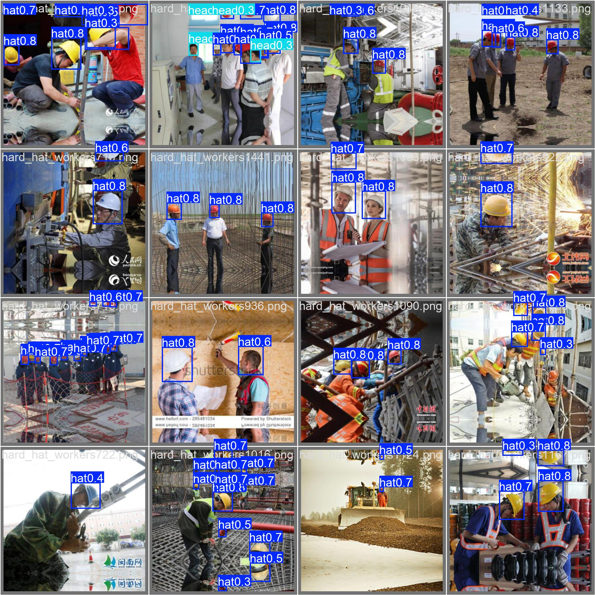
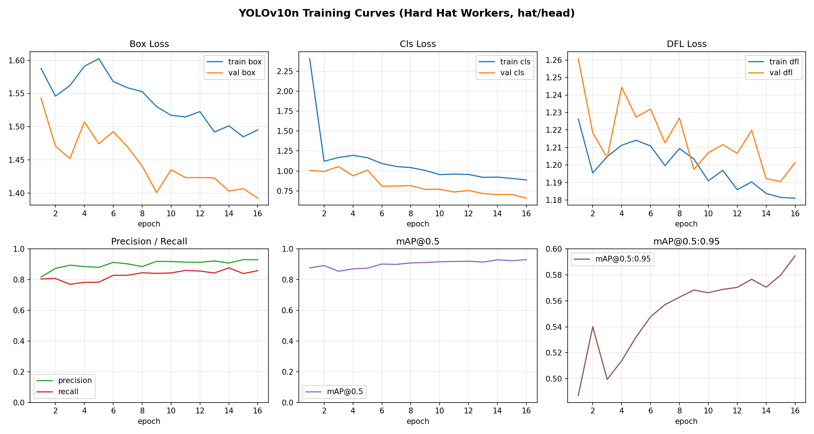
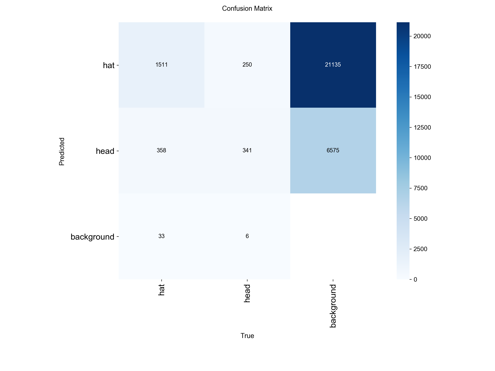

# 基于 YOLOv10 的施工现场安全帽佩戴检测

2 分类目标检测：`hat`（佩戴安全帽）/ `head`（未佩戴安全帽的裸头）。
实现并训练 YOLOv10n，从数据清洗、GPU 训练到评估出图的完整 CV pipeline。

## Results

**检测效果（测试集）：**



**训练曲线（loss / Precision-Recall / mAP）：**



**混淆矩阵：**



| Model | Split | Precision | Recall | mAP@0.5 | mAP@0.5:0.95 |
|---|---|---|---|---|---|
| YOLOv10n | Val | 0.930 | 0.858 | **0.930** | 0.594 |
| YOLOv10n | Test | 0.921 | 0.812 | **0.903** | 0.588 |

- 模型仅 2.28M 参数 / 6.7 GFLOPs，单图推理约 6 ms（≈160 FPS）。
- 更多图（PR/F1 曲线、真值 vs 预测、检测样例）见 [`pics/`](pics/)。

> 注：当前为训练约 16 轮的中间结果，mAP@0.5 仍在上升。数据集采用公开 Hard Hat Workers（5000 张工地图，已对齐为 hat/head 两类）。

## 目录结构

```
helmet_yolov10/
├── configs/
│   └── shwd.yaml                 # ultralytics 数据集配置（路径自动改写）
├── scripts/
│   ├── common.py                 # 公共路径与常量
│   ├── 01_download_shwd.py       # 下载 SHWD（git clone，含手动下载兜底）
│   ├── 02_voc_to_yolo.py         # VOC XML 批量转 YOLO 标签
│   ├── 03_split_dataset.py       # 8:1:1 划分 train/val/test 并组装目录
│   ├── 04_visualize_and_check.py # 脏数据筛查 + 样本可视化
│   ├── 05_train.py               # YOLOv10n/s 训练
│   ├── 06_val_predict.py         # 测试集评估 + 检测可视化 + 指标汇总
│   └── run_stage1.py             # 阶段1 一键流水线
├── data/
│   ├── raw/                      # 原始数据
│   └── processed/                # 转换后的 YOLO 数据集（运行后生成）
└── outputs/                      # 报告、训练输出（运行后生成）
```

## 环境准备

```bash
# 1. 建议 conda 新建环境
conda create -n helmet python=3.10 -y
conda activate helmet

# 2. 安装 GPU 版 PyTorch（按本机 CUDA 版本，见 https://pytorch.org）
pip install torch torchvision --index-url https://download.pytorch.org/whl/cu121

# 3. 安装其余依赖
pip install -r requirements.txt
```

## 阶段 1：数据集准备与预处理（半天以内）

一键运行：

```bash
python scripts/run_stage1.py
```

等价于按顺序执行：

```bash
python scripts/01_download_shwd.py        # 下载（网络失败会打印手动下载指引）
python scripts/02_voc_to_yolo.py          # VOC -> YOLO，输出转换报告
python scripts/03_split_dataset.py        # 8:1:1 划分，seed=42 可复现
python scripts/04_visualize_and_check.py  # 脏数据筛查 + 样本拼图
```

完成后检查：

- `outputs/reports/conversion_report.json`：转换统计（类别实例数、异常框）；
- `outputs/reports/dataset_report.txt`：数据质量报告（损坏图、重复图、越界框、尺度分布）；
- `outputs/reports/issues.csv`：全部问题明细；
- `outputs/reports/samples/samples_{train,val,test}.jpg`：画框样本图，人工核对标注是否正确；
- `data/processed/`：images/labels 成对的 train/val/test 目录。

SHWD 标注质量稳定，正常情况下 issues.csv 中不应出现 corrupt_image；
若出现少量越界截断框，脚本已自动修正，不影响训练。

## 阶段 2：YOLOv10 基线训练（有效工作量 1~1.5 天）

```bash
# 训练（100 轮，12G 显存默认 batch=16，约 6~10 小时，挂机即可）
python scripts/05_train.py --model yolov10n.pt --epochs 100 --batch 16

# 12G 显存若想跑稍大的模型：
python scripts/05_train.py --model yolov10s.pt --epochs 100 --batch 8

# 测试集评估 + 结果可视化
python scripts/06_val_predict.py
```

产物（位于 `outputs/runs/shwd_yolov10n/`）：

| 文件 | 内容 |
|---|---|
| `weights/best.pt` | 验证集 mAP 最优权重 |
| `results.png` | loss / Precision / Recall / mAP 训练曲线 |
| `results.csv` | 每轮指标明细 |
| `confusion_matrix.png` | 混淆矩阵 |
| `val_batch*_pred.jpg` | 验证集预测可视化 |
| `outputs/reports/metrics_summary.json` | val/test 的 P、R、mAP@0.5、mAP@0.5:0.95 汇总 |
| `outputs/reports/detections/test/` | 测试集检测结果图 |

## 评价指标口径

- **mAP@0.5**：IoU 阈值 0.5 下的平均精度，安全帽检测任务的主指标；
- **mAP@0.5:0.95**：IoU 从 0.5 到 0.95（步长 0.05）的平均，衡量框定位精度；
- 同时报告 Precision、Recall 与每类 AP（hat / head）。

## 常见排错

1. `git clone` 失败：按脚本提示手动下载 ZIP，把 `VOC2028` 放到 `data/raw/` 下即可。
2. `CUDA out of memory`：调小 `--batch`（16→8→4），或改用 `yolov10n.pt`。
3. 训练时 `labels not found`：确认 `data/processed/images` 与 `labels` 同级且文件名一致（阶段1脚本自动保证）。
4. ultralytics 找不到 yolov10：升级版本 `pip install -U ultralytics`。
